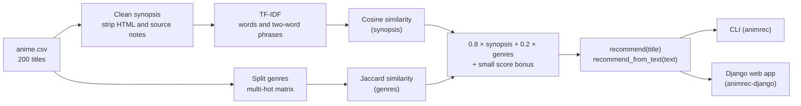
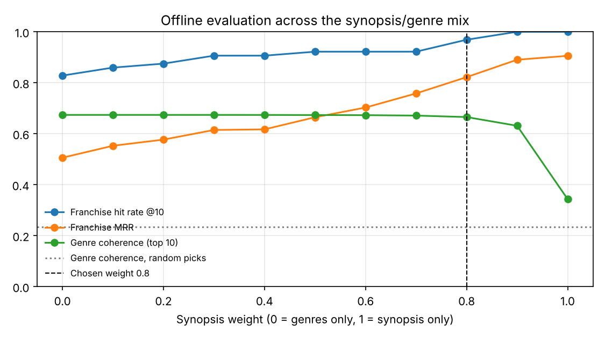

<div align="center">

# AnimRec: Content-Based Anime Recommender

**A recommender that suggests anime similar to a show you like, or to a short description you type, by combining what the synopses say with which genres the shows share. This repository holds the model as an installable Python package, which also powers the [AnimRec Django web app](https://github.com/Collinsthe4th/animrec-django).**

[](https://github.com/Collinsthe4th/anime-recommendation-system/actions/workflows/ci.yml)
[](https://www.python.org/)
[](https://scikit-learn.org/)

</div>

---

## Contents

- [About the project](#about-the-project)
- [How it works](#how-it-works)
- [Tech stack](#tech-stack)
- [Evaluation](#evaluation)
- [Interactive dashboard](#interactive-dashboard)
- [Getting started](#getting-started)
- [Using the package](#using-the-package)
- [Project structure](#project-structure)
- [Limitations](#limitations)

## About the project

When there are no user ratings to learn from, a recommender has to rely on what it knows about the items themselves. This is called content-based filtering. The catalogue here has 200 anime with a title, synopsis, genres, episode count, community score and main characters.

I built the model as a small package so that it can be used in two places without copying code. This repository holds the model, its evaluation and a command-line tool. The [animrec-django](https://github.com/Collinsthe4th/animrec-django) repository installs this package and puts a web interface on top of it.

## How it works



1. **Synopsis similarity.** Each synopsis is turned into a TF-IDF vector (term frequency-inverse document frequency, a score that is high for words that are common in one synopsis but rare across the catalogue). Two shows are compared with cosine similarity.
2. **Genre similarity.** Two shows are compared with Jaccard similarity (the number of shared genres divided by the number of genres of both shows together).
3. **Blend.** The final score is 0.8 × synopsis similarity + 0.2 × genre similarity. A small bonus based on the community score (0.05 at most) breaks near-ties in favour of better-rated shows.

Every recommendation comes with its synopsis similarity, genre similarity and shared genres, so the web app can explain why a show was suggested.

## Tech stack

| Area | Tools |
|---|---|
| Text features | scikit-learn `TfidfVectorizer` (English stop words, 1 to 2-word phrases) |
| Similarity | cosine similarity, Jaccard similarity (NumPy) |
| Packaging | `pyproject.toml`, bundled catalogue, `animrec` console script |
| Evaluation | franchise retrieval (hit rate, MRR), genre coherence, weight sweep |
| Testing | pytest, GitHub Actions |

## Evaluation

There are no user ratings, so I could not measure accuracy in the usual way. Instead I used two checks that do not need ratings.

1. **Franchise retrieval.** 64 titles in the catalogue have at least one other entry from the same franchise, for example the Gundam series or the Evangelion films. The model is never told about franchises, so if it ranks the other entries near the top, it has understood the content. I measured the hit rate (share of titles with a sibling in the top 5 or top 10) and the MRR (mean reciprocal rank, which is 1 when the first sibling is ranked first and 0.5 when it is ranked second).
2. **Genre coherence.** The average Jaccard genre overlap between a title and its top 10 recommendations. Random picks score 0.233.

| Synopsis weight | Hit rate @5 | Hit rate @10 | MRR | Genre coherence |
|---|---|---|---|---|
| 0.0 (genres only) | 0.641 | 0.828 | 0.506 | 0.674 |
| 0.6 | 0.844 | 0.922 | 0.703 | 0.673 |
| **0.8 (chosen)** | **0.891** | **0.969** | **0.822** | **0.665** |
| 1.0 (synopsis only) | 0.969 | 1.000 | 0.906 | 0.343 |

Table 1- Offline evaluation for a few points of the weight sweep (all points are in `results/metrics.json`).



Fig. 1- Franchise retrieval and genre coherence as the synopsis weight goes from 0 to 1. Source: Collins Akagha (2026).

The two checks pull in opposite directions. Using only the synopsis finds sequels best (MRR of 0.906), but its genre coherence falls to 0.343, close to random picks. Upon further research, I found that this is because sequels share character names, which TF-IDF picks up very strongly, while the rest of the top 10 is filled with shows that happen to share a few words. Using only genres gives on-genre suggestions but ranks sequels poorly (MRR of 0.506).

I first set the weight to 0.6. The sweep showed that 0.8 is better, as it raises the MRR from 0.703 to 0.822 while genre coherence only drops from 0.673 to 0.665. I made the rule explicit in `scripts/evaluate.py`: choose the highest MRR among the weights whose genre coherence is within 0.01 of the best. This means that the default is picked by the evaluation and not by hand.

## Interactive dashboard

The Streamlit app (`streamlit_app.py`) is the live demo of AnimRec. You can pick a title or type a description, filter by genre, and see why each show was recommended. The [Django version](https://github.com/Collinsthe4th/animrec-django) uses the same model.

```bash
streamlit run streamlit_app.py
```

## Getting started

```bash
git clone https://github.com/Collinsthe4th/anime-recommendation-system.git
cd anime-recommendation-system
python -m venv .venv && source .venv/bin/activate   # Windows: .venv\Scripts\activate
pip install -e . pytest

animrec "Cowboy Bebop"                                   # typos and partial titles are fine
animrec "evangelion" -k 5 --genre Mecha
animrec --describe "high school students playing basketball"
python scripts/evaluate.py                               # rebuilds results/metrics.json and the figure
python -m pytest -q
```

## Using the package

```python
from animrec import AnimeRecommender

rec = AnimeRecommender.from_csv()          # bundled 200-title catalogue
for r in rec.recommend("trigun", k=5):
    print(r.title, r.similarity, r.shared_genres)

rec.recommend_from_text("a detective solving cases in a quiet town", k=5)
rec.search("gund")                          # titles for an autocomplete box
```

Other projects can install it straight from GitHub:

```bash
pip install "animrec @ git+https://github.com/Collinsthe4th/anime-recommendation-system.git"
```

## Project structure

```
anime-recommendation-system/
├── src/animrec/
│   ├── recommender.py    # AnimeRecommender, Recommendation, similarity functions
│   ├── cli.py            # the animrec command
│   └── data/anime.csv    # bundled catalogue (200 titles)
├── scripts/evaluate.py   # franchise retrieval, genre coherence, weight sweep
├── results/              # metrics.json and figures/
└── tests/                # pytest unit tests
```

## Limitations

The catalogue is small (200 titles, mostly from the 1990s and early 2000s), so recommendations are limited to what it holds. A content-based model also cannot learn taste from other users, for example that fans of one show often enjoy another show with a different genre and story. Finally, the franchise check uses the first two words of the title, which is a rough rule. It groups the correct titles in almost every case, but a few groups (such as "Mahou Shoujo") may mix unrelated shows.

In conclusion, a blend of 80% synopsis and 20% genre similarity finds a franchise sibling in the top 10 for 96.9% of titles while keeping recommendations as on-genre as a genre-only model.
